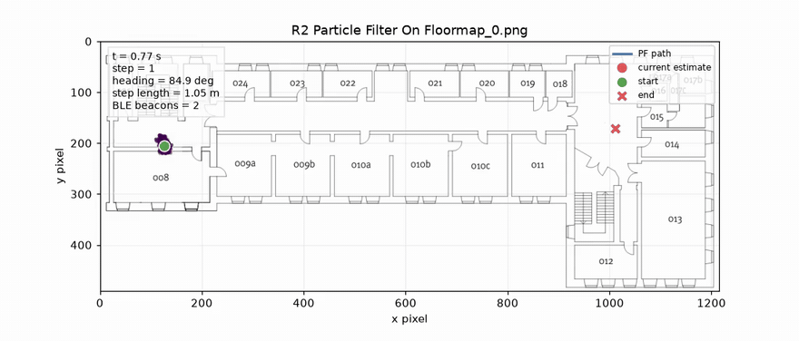
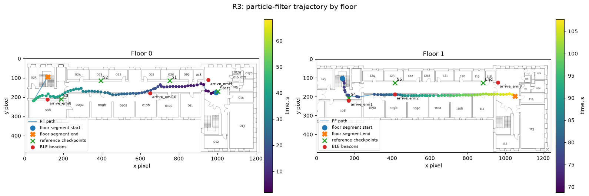
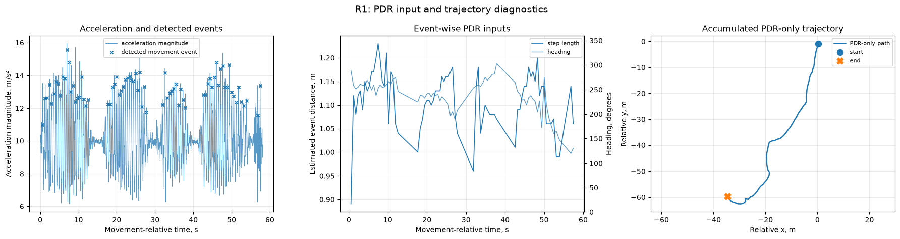
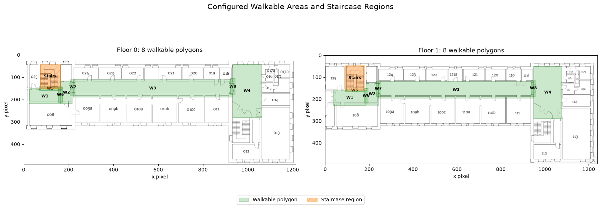

# Indoor Localization with Smartphone PDR, BLE Beacons and a Particle Filter

Tracking a walking person inside a university building, where GPS doesn't work, using only a smartphone's IMU, a few BLE beacons and the floor plan.

- **Pedestrian dead reckoning (PDR)** turns accelerometer peaks into steps, estimates each step's length and heading, and integrates them into a path.
- **BLE beacons** give a rough absolute position that doesn't drift.
- **A particle filter** fuses the two, keeps the estimate inside walkable areas of the floor plan, and moves the particle cloud between floors when it detects a staircase.

Group project (Group E) for the *Embedded Intelligence* course, M.Sc. AI for Industrial Applications, OTH Amberg-Weiden (Summer 2026), by **Arpitha Thimmegowda, Darshan Morkar and Venkata Kishore Dannana**.



<p>

</p>

## Results

Four recorded walks, evaluated against 22 manually timed checkpoints (doors passed during the walk). Only the start point is given to the filter; the later checkpoints are used purely for evaluation.

| Run | Route | Checkpoints | Mean error | RMSE |
|---|---|---|---|---|
| R1 | Zig-zag, ground floor | 5 | 3.26 m | 3.50 m |
| R2 | Zig-zag, reverse of R1 | 5 | 2.03 m | 2.40 m |
| R3 | Straight, ground floor → stairs → first floor | 7 | 6.86 m | 8.01 m |
| R4 | Straight with U-turn, first floor | 5 | 2.43 m | 2.63 m |
| **All** | | **22** | **3.94 m** | **5.11 m** |

The single-floor runs stay within about 2.4–3.5 m RMSE. In R3 the stair transition is detected correctly (floor 0 → 1 between 49 s and 69 s, confidence 0.82), but heading and distance errors built up on the long straight corridor beforehand, so the error is much larger. Detecting the right floor isn't enough when the horizontal estimate has already drifted.

Particle-filter animations for every run are in [`docs/videos/`](docs/videos/). The particle cloud is coloured by weight.

## How it works

```
raw CSV ─► clean & sync ─► step detection + PDR ─► BLE weighting ─► particle filter ─► evaluation
                                                     (map constraint, floor transitions)
```

1. **Clean and synchronise.** Each run's IMU and BLE events go onto one run-relative time axis. Invalid RSSI values (missing, positive, or the Android sentinel 127) and duplicate rows are dropped. Nothing is resampled; BLE readings are matched to steps through short time windows instead.
2. **Step detection.** The acceleration magnitude is smoothed and de-trended with a longer moving average. Peaks above an adaptive threshold, max(0.60, mean + 0.8·std), at least 0.35 s apart, count as steps.
3. **Step length and heading.** Step length uses Weinberg's model, L = 0.70 · (a_max − a_min)^¼. Heading comes from the phone's fused orientation, corrected with integrated gyroscope data on sharp turns (over 20°).
4. **BLE weighting.** For each step, the strongest RSSI per beacon in a ±0.75 s window is kept. RSSI is converted to linear power, so stronger beacons get more weight without weaker ones being discarded.
5. **Particle filter.** It uses 1,000 particles, each with a position and its own heading bias. Prediction applies the measured step with noise: 0.2 m on step length, 7° on heading, and 0.8° per step of heading drift. The weights are updated with a log-distance path-loss likelihood for the two strongest beacons. Particles outside the walkable polygons get zero weight, and the filter resamples when the effective sample size drops.
6. **Floor transitions.** A staircase detector moves the particle cloud to the next floor's map.
7. **Evaluation.** Each checkpoint is compared with the filter estimate closest in time on the same floor. Errors are converted from map pixels to metres.

<p>


</p>

## Running it

```bash
pip install -r requirements.txt
jupyter notebook Indoor_Localization_Report.ipynb   # Kernel → Restart Kernel and Run All Cells
```

Start Jupyter from the repository root, because the notebook resolves paths from the working directory. A full run takes about a minute. It writes everything it needs to `data/processed/` (not tracked) and gives the results above; the particle filter is seeded, so they are reproducible. The final cell creates the particle-cloud animations. Their output was removed from the committed notebook because it was over 40 MB; the same animations are in `docs/videos/`.

## Repository layout

```
Indoor_Localization_Report.ipynb   report + full pipeline (executed)
Floormap_0.png, floormap_1.png     floor plans (ground and first floor)
runs_document.md                   run protocol: routes, roles, checkpoint times
data/raw/                          smartphone recordings, one CSV per run
data/metadata/                     beacon positions, reference checkpoints, walkable polygons
docs/images, docs/videos           figures and particle-filter animations
```

## Notes on this public version

- The authors' e-mail addresses were removed from the notebook header.
- The raw BLE scans also picked up passers-by's devices (phones, headphones). Their MAC addresses and advertisement data were blanked. The rows were kept, so the pipeline's output doesn't change.
- The RMSE values quoted in the notebook's Discussion and Conclusion were updated to match the executed results above.
